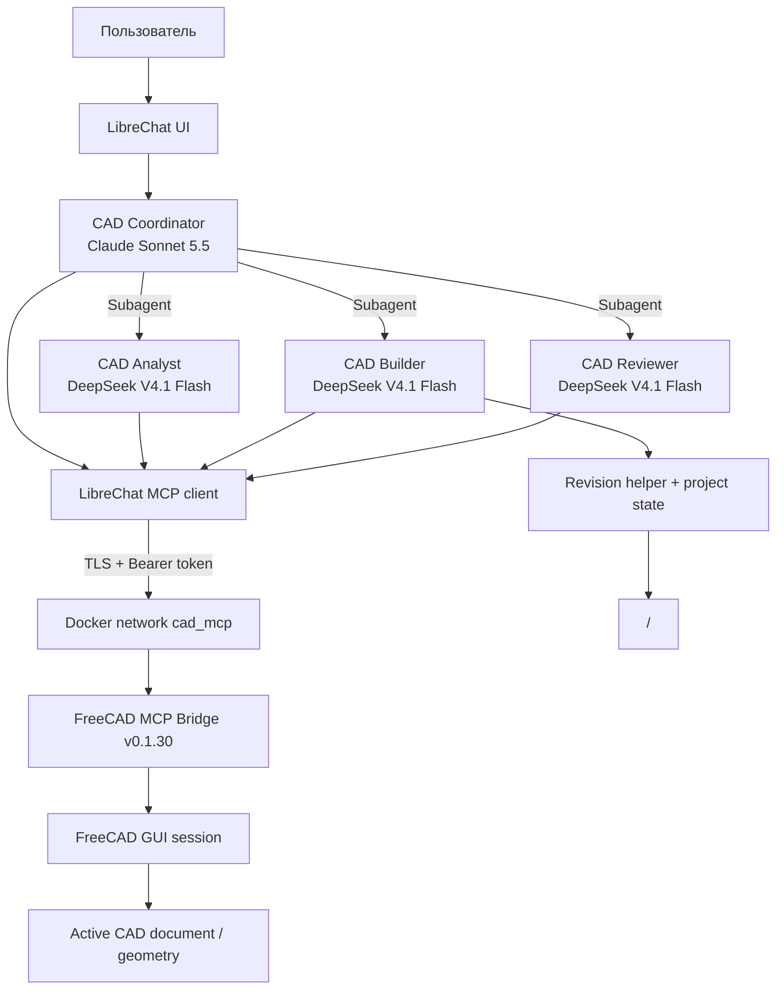

# Архитектура CAD Agent Team

## Логическая схема

Все агенты имеют прямой MCP tool assignment v2/v3 по отчётам. Coordinator может запускать Analyst/Builder/Reviewer через настоящий LibreChat `subagent`. У одной FreeCAD GUI-сессии общий MCP endpoint, поэтому мутации должны выполняться строго последовательно.

## Эволюция архитектуры

### v1.0 — single-writer (16 Nov)

- Coordinator — единственный агент с прямым FreeCAD MCP.
- Analyst, Builder, Reviewer — работают с переданными snapshot/метриками/кодом, без прямого исполнения в FreeCAD.
- Bridge оставался в Ask; пользователь подтверждал каждый Python-вызов.
- Это была безопаснее с точки зрения одного writer, но Coordinator становился узким местом.

Источник: `history/packages/v1/` и `source-archives/CAD_Agent_Team_Package_2026-11-16.zip`.

### v2.0 — direct MCP for all four (16 Nov)

- Все четыре агента получили `execute_python_mcp_freecad` и `get_output_page_mcp_freecad`.
- `execute_python_file_mcp_freecad` не включён в явный MVP toolset.
- Coordinator Subagents: enabled, `allowSelf=false`, `shareFiles=true`, child IDs Analyst/Builder/Reviewer.
- Все агенты работают с одной живой FreeCAD-сессией; это повышает автономность, но не обеспечивает техническую изоляцию.
- v2 Coordinator ещё допускал небольшие понятные изменения самостоятельно.

Источник: `history/packages/v2/` и `source-archives/CAD_Agent_Team_Package_v2_2026-11-16.zip`.

### v3 — role hardening + Skills (17 Nov)

- Coordinator не должен создавать или менять геометрию/CAD-документ; любую такую работу делегирует Builder.
- Analyst вызывается при неизвестном, изменённом, устаревшем или противоречивом состоянии.
- Reviewer вызывается после существенных/рискованных изменений и на milestone.
- Для мутаций требуется before snapshot, затем change/recompute/verification/after snapshot и project state update.
- Six Skills imported; each agent receives exactly three Selected Skills: two common + one role-specific.
- Поздний отчёт 13:22 UTC сообщает, что все четыре агента обновлены v3 prompts, `skills_enabled=true`, `skills_scope=selected`, models/provider/MCP/Subagents/IDs unchanged.

Точный v3 Coordinator prompt сохранён. Три остальных v3 prompts в доступной Library не обнаружены; известны только их SHA-256 (см. `agents/v3/README.md`).

## Single-writer requirement

В одной живой FreeCAD GUI-сессии запрещены параллельные изменения. Reviewer не должен выполнять read-only проверку одновременно с Builder mutation. Coordinator ждёт завершения текущей изменяющей задачи и только затем передаёт следующий job.

## Context handoff

Каждому subagent передаётся компактный пакет: проект, текущая ревизия, имя активного документа, изменяемые объекты, подтверждённые размеры, ограничения, acceptance criteria, `project_root`, доступные MCP tools. Subagent не наследует всю историю Coordinator.
